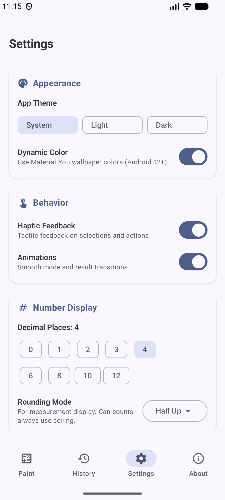
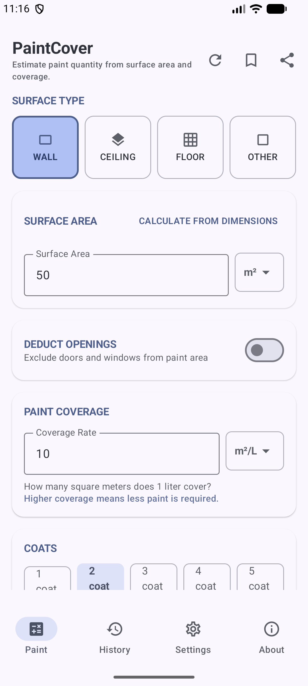
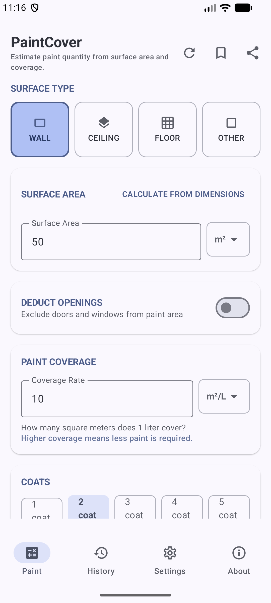
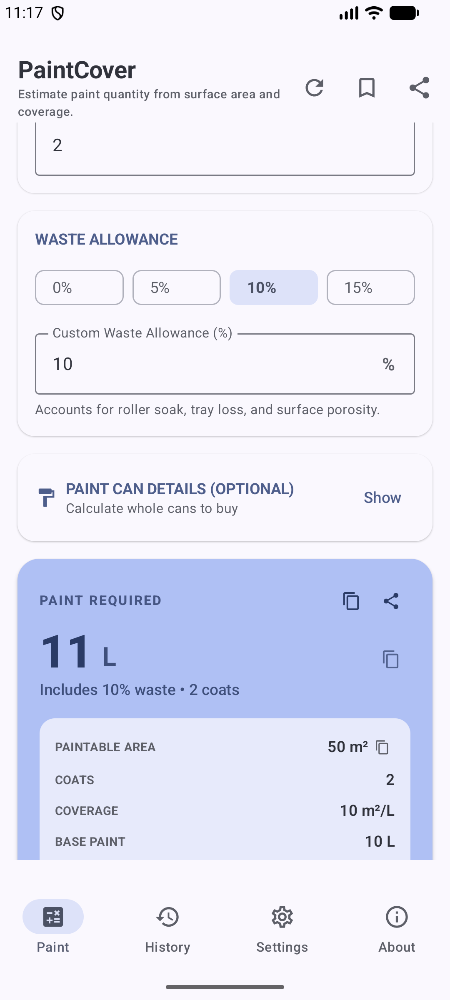

# 🎨 PaintCover - Smart Paint & Surface Coverage Calculator

**PaintCover** is a modern, intuitive, and comprehensive Android application built with **Kotlin** and **Jetpack Compose**. It helps painters, contractors, and DIY enthusiasts accurately calculate required paint volume, deduct windows and doors, factor in surface porosity and waste allowance, estimate can counts and total costs, and track calculation history.

---

## 📱 Screenshots

| Home & Input | Surface & Openings | Primary Result | Step Breakdown |
| :---: | :---: | :---: | :---: |
|  |  |  |  |

---

## ✨ Features

- **📐 Precise Area & Surface Calculations**:
  - Direct dimensions (Length × Height) or custom total surface area input.
  - Support for multiple surface types (Smooth/Sealed, Normal/Drywall, Rough/Textured) with automatically adjusted coverage factors.

- **🚪 Openings Deduction**:
  - Add and subtract doors, windows, or custom non-painted areas easily.

- **🖌️ Coat & Waste Management**:
  - Custom number of coats (1 to 10).
  - Configurable waste/spill allowance percentage.

- **🥫 Paint Can & Cost Estimator**:
  - Support for standard container sizes (1L, 2.5L, 5L, 10L, 1 Gal, 5 Gal, etc.).
  - Total cans required calculation and total project cost estimation.

- **📊 Visual Diagram & Step-by-Step Formulas**:
  - Interactive formula card and visual coverage diagram.
  - Comprehensive step-by-step breakdown of calculations.

- **📜 History & Saved Calculations**:
  - Save past calculations for quick reference.
  - Delete or clear history entries as needed.

- **⚙️ Settings & Customization**:
  - Toggle between **Metric** (m, m², Liters) and **Imperial** (ft, ft², Gallons) units.
  - Rounding modes (Nearest integer, 1 decimal place, 2 decimal places, or Ceil to whole cans).
  - **Dynamic Colors** and **Dark Mode** support (Light, Dark, System default).

---

## 🛠️ Architecture & Tech Stack

PaintCover follows modern Android development best practices with **Clean Architecture**:

- **Language**: [Kotlin](https://kotlinlang.org/)
- **UI Framework**: [Jetpack Compose](https://developer.android.com/jetpack/compose) with Material 3 design elements.
- **Architecture**: Clean Architecture (Domain, Data, UI) with Unidirectional Data Flow (UDF).
- **State Management**: Android `ViewModel`, `StateFlow`, and `UiState`.
- **Navigation**: [Jetpack Navigation Compose](https://developer.android.com/jetpack/compose/navigation).
- **Testing**: JUnit 4 unit test suite covering math converters, calculators, parsers, and viewmodel logic.

---

## 📂 Project Structure

```
PaintCover/
├── app/
│   └── src/
│       ├── main/
│       │   └── java/com/example/paintcover/
│       │       ├── data/             # Data models and repositories (History, Settings)
│       │       ├── domain/math/      # Calculator logic, unit converters, formatters, validators
│       │       ├── ui/               # Compose screens, components, theme & navigation
│       │       │   ├── home/         # Home screen & calculation cards
│       │       │   ├── history/      # History tracking screen
│       │       │   ├── settings/     # App settings screen
│       │       │   ├── about/        # About & app info screen
│       │       │   └── theme/        # Material 3 colors, typography & shapes
│       │       └── MainActivity.kt
│       └── test/                     # Comprehensive unit test suite
├── screen.png                        # App screenshot 1
├── screen_paint.png                  # App screenshot 2
├── screen_result.png                 # App screenshot 3
└── screen_result2.png                # App screenshot 4
```

---

## 🚀 Getting Started

### Prerequisites
- **Android Studio**: Ladybug / 2024.2.1 or newer recommended.
- **JDK**: Java 17.
- **Android SDK**: Minimum SDK 26 (Android 8.0), Target SDK 37.

### Build and Run
1. Clone the repository:
   ```bash
   git clone https://github.com/abdullah-ateeq/PaintCover.git
   cd PaintCover
   ```
2. Open the project in **Android Studio**.
3. Sync Gradle dependencies.
4. Run on an Android Emulator or connected physical device.

---

## 🧪 Running Unit Tests

To run the unit tests via Gradle command line:
```bash
./gradlew test
```

---

## 📄 License

This project is licensed under the MIT License - see the [LICENSE](LICENSE) file for details.
